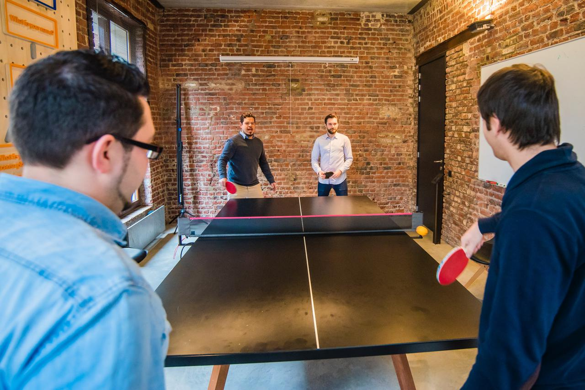

Employee engagement measures how invested employees are in devoting their whole selves to improving outcomes for organizations. High engagement means your teams find the work they do rewarding and significant. There’s an undercurrent of passion in companies with creative employee engagement activities. People bring creativity, dedication, and a zeal for work to everything they do.

## Peer-to-peer rewards and recognition

Team building doesn’t have to be a chore or boring. Peer-to-peer rewards allow employees to recognize each other for exceptional work with tangible benefits. Instead of relying on management to see when employees go above and beyond, team members can recognize each other with all kinds of recognition, including:

-   Monetary bonuses

-   Elite parking spaces

-   Swag such as water bottles, clothing, and gear

-   Gift cards

Peer-to-peer rewards are a great way to build collaborative teamwork within an organization and motivate employees to go further in the day-to-day.

## Learning lunches and training programs

Professional development helps employees visualize their future within your organization by training new skill sets, introducing new technology, and improving workflow processes. But often, training seminars are a drag that employees simply endure as part of their workday.

With great catering and dynamic instructors, learning lunches can bring together an organization and get employees excited about learning. Pairing rewards and recognition with ongoing training gives employees additional motivation and encouragement to learn challenging material and advance their skills.

## Community building activities

During the workday, it can be rare for your C-suite to spend time with employees throughout your organization. When you take time out of the work week for holiday parties, it can bring together people from throughout your organization.

Encouraging staff to invite their families to parties and community-building activities demonstrates that they can bring their whole selves to work daily. When your organization recognizes employees as multifaceted people with other obligations and responsibilities, they give more at work.

## Sports leagues and events

When you put together sports teams for your organization, such as softball, bowling, or running clubs, employees across the company can come together to enjoy common interests. Building teamwork outside of the office goes a long way to encouraging collaboration during work hours.

Good-natured competition makes people excited to come to work every day and doesn’t take a lot of effort to plan. You can create tournaments for everything from bake-offs to fantasy football.

## Fundraisers and community give-back days

When a company shows they care about more than quarterly profits, employees find rewards in their work beyond their paycheck. Spending time away from the office to give back to the community through volunteering and other involvement programs is a great way to unite employees and leadership.

Conducting fundraisers for issues and programs that matter the most to your employees is a great way to align their passion with that of your organization. Engagement rises when employees are working in places that hold the same values as them.

## Schedule a consultation with Socius Strategies to learn employee engagement activities to drive transformation.

Socius Strategie brings a collaborative approach to HR support. We empower transformation at the individual and organizational levels. Our consulting services focus on supporting diversity, equality, inclusion, and belonging in leadership and throughout all levels of a company. When people feel able to bring their whole selves to work, team performance improves. Our goal for everyone we work with is to help them generate sustainable growth now and in the future.

We support the human aspects of business, the places where you find limitless potential to meet the challenges of the future and command a more significant market share. Want to set and achieve new goals for your organization? Reach out to schedule a consultation to learn impactful employee engagement activities.
