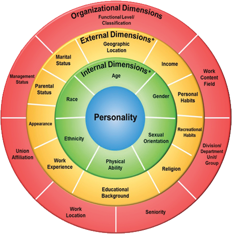

Here at Socius Strategies, we have been thinking about the concept of “**belonging**” lately and how it has evolved into the DEI collective consciousness. It seems odd to think that belonging has just begun to be discussed as an essential component.

This need to belong is a fundamental human need. It evolves from a desire for connection and community and for most of us, this comes from shared commonalities, values, behaviors, or foundational beliefs. These different aspects of our identity are vital to understanding who we are, how we see ourselves within the world, and how the world sees us.

Our identity is multifaceted, and we want to be seen and appreciated for all of the unique parts that make up who we are. So we approach the concept of identity using a holistic model presented by Lee Gardenswartz and Anita Rowe ([https://www.gardenswartzrowe.com/](https://www.gardenswartzrowe.com/)) because it takes into account the organization as a component of identity.

Here, the individual’s personality and individual identity are at the center of their four-layered circle. The next layer, the “internal dimensions,” are the things we don’t have control over (i.e., age, gender, and ethnicity) but influence how we are treated, the roles we play in life, and our expectations. The third layer, the “external dimension,” is where there can be input and control of the individual’s circumstances; geographic location, marital status, recreational habits, etc. The outer circle, known as the organizational dimensions, includes the work environment. This model provides perspective in considering how individuals can see themselves and therefore be either included or excluded within any context.

So, when we think of **inclusion, belonging, and identity**, we think of it this way;

-   **Inclusion is the action** – it is behavior intended to positively connect people. It draws upon our identity to help make those connections.

-   **Belonging is the feeling** – it is that feeling of being valued and seen for who you are and for how you show up in the world. It is the feeling of appreciation for all aspects of your identity and uniqueness.

As leaders, we have an opportunity (aka, obligation) to create places where colleagues can feel as though they belong. By creating a culture of belonging, an organization sets the foundation for employees to flourish and do their best work. In my experience, successful leaders develop these cultures of belonging through CSC©….

-   **Challenge** – these leaders question systematic processes and structure for fairness and equity, and they do so in a collaborative and solutions-oriented way.

-   **Support** – they champion their team members in their identity. They have trusting and honest relationships with peers and colleagues that “assume good intention.”

-   **Create** – these individuals facilitate honest and open dialogues that build an environment for uniqueness, belonging, and collective engagement.

These intentional behaviors and actions can be the first steps in creating a culture of belonging and engaged employees. Want to learn more? reach out to us at Socius Strategies
